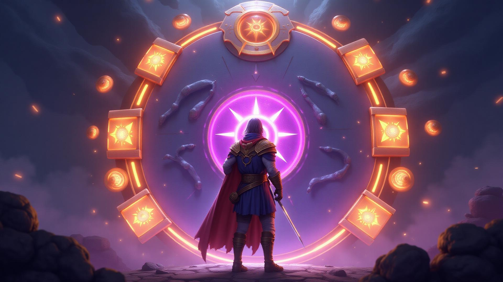

# Hero Your Tasks — Task Level



Aplicação web de produtividade que transforma tarefas, hábitos e metas do dia a dia em uma jornada gamificada. O usuário conclui missões, ganha XP, mantém sequências, sobe de nível e acompanha sua evolução em uma experiência inspirada em jogos de RPG.

> Projeto autoral desenvolvido por **Gabriel Oliveira** para portfólio. O código está disponível para avaliação técnica; os direitos de uso e redistribuição permanecem reservados.

## Demonstração

**Aplicação:** [hero-your-tasks.vercel.app](https://hero-your-tasks.vercel.app)

O projeto é uma PWA responsiva e pode ser instalado no celular ou no computador diretamente pelo navegador.

## O que a aplicação oferece

- **Missões diárias:** criação e acompanhamento de tarefas individuais ou em grupo.
- **Hábitos e sequências:** registro de consistência e visualização do progresso ao longo do tempo.
- **Sistema de XP e níveis:** cada atividade concluída contribui para a evolução do perfil.
- **Ranking:** comparação de desempenho e incentivo saudável à constância.
- **Perfil personalizável:** avatares, mascotes, montarias e recompensas desbloqueáveis.
- **Loja virtual:** uso das recompensas conquistadas dentro da experiência.
- **Painel financeiro:** organização de receitas e despesas pessoais.
- **Assistente de IA:** área experimental para apoio à organização e produtividade.
- **Quiz e diagnóstico:** jornada inicial para identificar o perfil de produtividade do usuário.
- **PWA:** experiência instalável com suporte a uso em diferentes dispositivos.

## Proposta do produto

O Hero Your Tasks nasceu da ideia de tornar a organização pessoal menos mecânica. Em vez de mostrar apenas uma lista de afazeres, a aplicação dá contexto e recompensa ao progresso: tarefas viram missões, constância vira sequência e evolução pessoal vira nível.

Esse conceito combina produtividade, formação de hábitos e elementos de jogos em uma interface visual com identidade própria.

## Tecnologias

- React 18 e TypeScript
- Vite
- Tailwind CSS e shadcn/ui
- Supabase (autenticação, banco de dados e funções serverless)
- TanStack Query
- React Hook Form e Zod
- Recharts
- Vite PWA / Workbox
- Vercel

## Arquitetura

```text
Interface React
    ├── Landing page, quiz e onboarding
    ├── Dashboard, missões, hábitos e ranking
    ├── Perfil, loja, finanças e assistente
    └── PWA responsiva
              │
              ▼
Supabase
    ├── Autenticação
    ├── PostgreSQL com Row Level Security
    └── Edge Functions
```

## Executando localmente

Requisitos: Node.js 18 ou superior e npm.

```bash
git clone https://github.com/gabrielziver/hero-your-tasks.git
cd hero-your-tasks
npm install
cp .env.example .env
npm run dev
```

Preencha o arquivo `.env` com as credenciais públicas do seu projeto Supabase:

```env
VITE_SUPABASE_PROJECT_ID=seu_project_id
VITE_SUPABASE_PUBLISHABLE_KEY=sua_chave_publica
VITE_SUPABASE_URL=https://seu-projeto.supabase.co
```

## Segurança

- Credenciais privadas não fazem parte do repositório.
- O acesso aos dados é protegido por políticas de Row Level Security no Supabase.
- Cada usuário autenticado acessa apenas os registros permitidos pelas políticas do banco.
- Variáveis públicas do frontend são fornecidas por ambiente durante o build.

## Status e próximos passos

O projeto está em evolução. Entre as próximas melhorias planejadas estão o aprofundamento do assistente de IA, novos ciclos de recompensas, relatórios de produtividade e melhorias na experiência colaborativa.

## Autor

Desenvolvido por [Gabriel Oliveira](https://github.com/gabrielziver).

## Licença

Este projeto é disponibilizado publicamente apenas para apresentação em portfólio e avaliação profissional. Consulte o arquivo [LICENSE](LICENSE) para os termos de uso.
